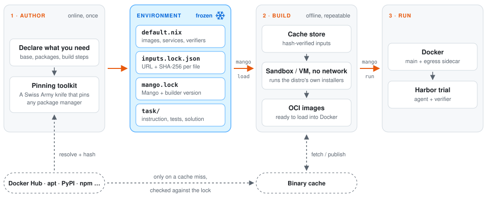

# Mango 🥭

Mango is a declarative DSL for RL environments, and a drop-in replacement for
Dockerfiles. Declare an environment once: Mango freezes every input it
depends on and builds it offline from then on. Environments run as ordinary
[Harbor](https://github.com/harbor-framework/harbor) tasks.

**[Read the documentation →](https://incalmo.github.io/mango/)**

- **Reproducible.** Base images, distro packages and language dependencies are
  pinned by content hash. An environment built next year contains the same
  files as the one built today; it never drifts.
- **Scalable.** Pinned inputs are fetched once and served from your own
  [binary cache](docs/remote-cache.md). Building 1,000 environments does not
  send 1,000 builds to Docker Hub, the Ubuntu archive, Maven Central or npm,
  so nothing gets throttled.
- **General.** Builds run the base image's own shell and installers, so any
  Linux distro works. Mango locks a package manager by recording what it
  downloads and replaying it offline, so it needs no per-language support:
  [25 package managers across 20 languages](docs/record-replay.md#verified-package-managers)
  are verified, and a new one works the same way.

## How it works

<picture>
  <source media="(prefers-color-scheme: dark)" srcset="docs/assets/architecture-dark.svg">
  
</picture>

Upstream registries are contacted while authoring, and afterwards only to
fill a cache miss, where the download must match the locked hash. The build
itself has no network, and every later build reads the same bytes from the
binary cache.

## Example

This converts `nginx-request-logging` from
[Terminal-Bench 2](https://github.com/laude-institute/terminal-bench-2) into a
Mango environment. You need Docker and Nix on Linux/amd64, and a checkout of
this repository. Run the commands from the checkout.

Both versions are in [`examples/nginx-request-logging`](examples/nginx-request-logging):
`dockerfile/` is the original task and `mango/` is the result of the steps below.
To skip ahead, run `./bin/mango load examples/nginx-request-logging/mango`.

The original `environment/Dockerfile`:

```dockerfile
FROM python:3.13-slim-bookworm
WORKDIR /app
RUN pip install requests==2.32.4
RUN apt-get update && apt-get install -y curl
```

Three of its four lines depend on when you build: the tag moves, `apt-get`
installs today's `curl`, and pip picks today's `urllib3`, `certifi`, `idna`
and `charset-normalizer`.

### 1. Lay out the environment

Copy the task, without its Dockerfile, under `task/`:

```sh
ENV=~/envs/nginx-request-logging
mkdir -p $ENV/task
cp -r examples/nginx-request-logging/dockerfile/{task.toml,instruction.md,tests,solution} $ENV/task/
```

### 2. Pin what the Dockerfile downloads

```sh
# FROM: resolve the tag to a digest and content hash
nix-shell --run 'mango-pin-base docker.io/library/python:3.13-slim-bookworm --nix'
BASE=docker.io/library/python@sha256:a5a7017e...   # the digest it printed

# apt-get install: resolve curl and its dependencies against a dated snapshot
nix-shell --run "mango-lock-packages --lock $ENV/inputs.lock.json --manager apt --base $BASE \
  --source 'deb https://snapshot.debian.org/archive/debian/20261101T000000Z bookworm main' \
  --source 'deb https://snapshot.debian.org/archive/debian/20261101T000000Z bookworm-updates main' \
  --source 'deb https://snapshot.debian.org/archive/debian-security/20261101T000000Z bookworm-security main' \
  --stage curl"

# pip install: resolve the wheels inside the pinned base
docker run --rm $BASE pip install -q --dry-run --ignore-installed \
  --report /dev/stdout requests==2.32.4 > report.json
nix-shell --run "mango-lock-python report.json --lock $ENV/inputs.lock.json --prefix python/app"
```

`inputs.lock.json` now lists 15 `.deb` files and 5 wheels, each with its URL
and SHA-256. `mango-lock-packages` prints the prefix its packages were stored
under (`apt/4c908884cf820836/0` here).

### 3. Write `default.nix`

```nix
{ harness }:
let
  h = import harness { };

  main = h.mkLinuxImage {
    name = "nginx-request-logging";

    # FROM python:3.13-slim-bookworm
    base = h.fetchLinuxBase {
      image = "docker.io/library/python";
      digest = "sha256:a5a7017efc5969e00ae2b91c8eb0631049a569652aa4ffc4501769049ae45c72";
      hash = "sha256-3bGHO8WdxydBabREP5FrDvfckM4U0HYH9riXCvqVrdY=";
    };

    # Every file the build may read, mounted at /.nix-inputs/files.
    inputs = h.dependencies.fetchLockedInputs { lock = ./inputs.lock.json; };

    # The RUN lines. There is no network here.
    buildScript = ''
      set -eu
      in=/.nix-inputs/files

      # RUN pip install requests==2.32.4
      pip install --no-index --find-links $in/python/app requests==2.32.4

      # RUN apt-get update && apt-get install -y curl
      dpkg -i $in/apt/4c908884cf820836/0/*.deb
    '';

    # WORKDIR /app
    config.WorkingDir = "/app";
  };
in
h.mkEnvironment {
  name = "nginx-request-logging";
  task = ./task;
  containers = { inherit main; egress = h.egressImage; };
  services.main.container = "main";
}
```

### 4. Build and run

```sh
./bin/mango load $ENV                 # build the images and load them into Docker
./bin/mango run $ENV --agent oracle   # run a Harbor trial with the reference solution
```

The oracle trial ends with `"reward": 1.0`. The first `load` also writes
`mango.lock`, which pins the Mango version the environment builds with.

`load` builds inside a [managed Docker builder](docs/managed-builder.md), so
the machine running environments needs Docker but not Nix. Add
`--builder host` to use an existing Nix installation instead.

When you are done, `./bin/mango clean $ENV` removes the environment's
workspace, its Docker images and the cached build results nothing else uses.

### Dockerfile vs. Mango

| Dockerfile | Mango | Why |
| --- | --- | --- |
| `FROM python:3.13-slim-bookworm` | `base = h.fetchLinuxBase { digest; hash; }` | The base image is pinned by digest and cached at authoring time, so builds never resolve the tag or pull from Docker Hub. |
| `RUN apt-get update && apt-get install -y curl` | `dpkg -i $in/apt/<key>/0/*.deb` | The 15 packages are resolved once at authoring time and cached by hash, so builds install those exact files without contacting the Debian archive. |
| `RUN pip install requests==2.32.4` | `pip install --no-index --find-links …` | The whole wheel closure is locked and cached at authoring time, so transitive dependencies cannot change and builds never query PyPI. |
| `WORKDIR /app` | `config.WorkingDir = "/app"` | Runtime configuration is declared rather than downloaded, so it carries over unchanged. |
| `docker build` with network | Offline build | With no network, a build can only use pinned inputs: a missing pin fails loudly instead of drifting silently. |

The resulting environment is three things you commit: `default.nix`,
`inputs.lock.json` and `mango.lock`, next to the unchanged `task/`.

## Documentation

The docs are published at **<https://incalmo.github.io/mango/>**, with search
and a Dockerfile-versus-Mango page for each of 20 languages. To preview
changes locally:

```sh
nix-shell docs.nix --run 'mkdocs serve'
```

Good starting points:

- [Languages](docs/languages/index.md): a Dockerfile and its Mango equivalent
  for Python, JavaScript, Java, C#, Go, Rust and 14 more.
- [How it works](docs/how-it-works.md): author online once, build offline.
- [Record and replay](docs/record-replay.md): lock any package manager by
  recording what its build downloads.
- [Declarative environments](docs/declarative-environments.md): `mkEnvironment`,
  services, verifiers and the `mango` commands.
- [Authoring tools](docs/authoring-tools.md): the `mango-pin-*` and
  `mango-lock-*` commands.
- [Managed builder and cleanup](docs/managed-builder.md) and
  [remote binary caches](docs/remote-cache.md).

Mango currently builds `linux/amd64` images on x86_64 Linux.

## License

MIT. See [LICENSE](LICENSE).
